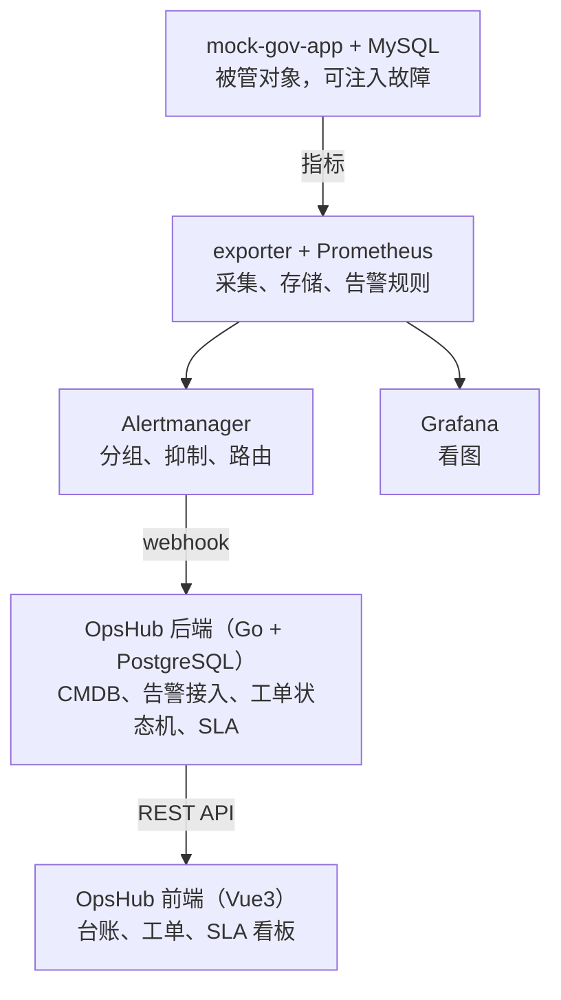

# OpsHub

小型 IT 运维管理平台，用来跑通政企运维的核心链路：

**系统出故障 → 监控自动发现 → 生成带 SLA 时限的工单并找到责任厂商 → 厂商按流程处理 → 考核数据自动更新。**

项目背景是约 200 个业务系统从各厂商划转过来后的管理问题：台账怎么建、告警怎么变成任务、怎么用数据考核外包厂商。这是一个学习型 Demo，不是生产级产品。

## 架构

采集、存储、告警计算全部用开源组件，自己只写"管理"那部分（CMDB、工单、SLA）。



## 主要功能

- **CMDB 台账**：厂商、业务系统、主机、系统依赖。工单能直接看到责任厂商和影响面，还会提示未登记的告警来源。
- **告警自动建单**：按 `system` 标签关联台账，按"系统等级 × 严重级别"计算响应和恢复截止时间。
- **告警去重**：同一告警指纹最多一张未关闭工单，由数据库部分唯一索引保证，并发推送也不会重复建单。
- **工单状态机**：受理、恢复、关闭、重开，非法跳转返回 409，每一步都写流水。告警恢复不会自动关单。
- **SLA 考核**：按系统或厂商统计故障数、MTTR、响应和恢复达标率、当前超时数。
- **故障注入**：一条命令制造变慢、报错、宕机，用来演示完整链路。

## 技术栈

| 部分 | 选型 |
|---|---|
| 后端 | Go、gin、pgx、sqlc、golang-migrate |
| 数据库 | PostgreSQL 16 |
| 前端 | Vue3、Vite、Element Plus、ECharts |
| 监控 | Prometheus、Alertmanager、Grafana、node_exporter、mysqld_exporter、blackbox_exporter |
| 部署 | docker compose |

## 快速开始

需要 Docker（含 compose 插件）和 Node.js。跑测试还需要 Go 1.27。

```bash
make up      # 构建并启动后端和监控组件
make seed    # 导入演示数据：台账和过去 30 天的历史工单
make web     # 另开一个终端启动前端
```

| 页面 | 地址 |
|---|---|
| OpsHub | http://localhost:5173 |
| Grafana | http://localhost:3000（端口冲突时在 `deploy/.env` 设置 `GRAFANA_PORT`） |
| Prometheus | http://localhost:9090 |
| Alertmanager | http://localhost:9093 |

配置中的账号密码都是本地演示用的固定值，不要直接部署到公网。

## 体验完整链路

```bash
make chaos-error   # 让 mock-gov-app 30% 的请求返回 500
```

大约 90 秒后，工单页会自动出现一张 P2 事件单，关联到 GOV-APPLY 和星河软件。在页面上受理并标记恢复，执行下面的命令恢复服务，再确认关单，SLA 看板的数据就会更新。

```bash
make chaos-reset
```

## 常用命令

```bash
make test              # 单元测试（含告警规则测试，不需要数据库）
make test-integration  # 集成测试，需先 make up
make demo-check        # 演示前自检
make demo-reset        # 清空工单并重新导入历史工单（会删除数据）
make chaos-slow        # 注入延迟故障
make chaos-down        # 停掉 mock-gov-app，触发探活失败告警
make down              # 停止容器
```

## 目录结构

```
backend/     Go 后端：api、service、领域逻辑（cmdb、alert、ticket、sla）、store、migrations
frontend/    Vue3 前端
mock/        模拟业务系统 mock-gov-app
deploy/      docker-compose、Prometheus、Alertmanager、Grafana 配置
docs/        任务清单、设计文档、演示脚本、实现手册
```

## 文档

- [演示脚本与常见追问](docs/DEMO.md)
- [分阶段任务清单](docs/PLAN.md)
- [设计文档](docs/superpowers/specs/2026-10-30-opshub-design.md)
- [实现手册](docs/opshub-handbook.html)：后端实现过程与表结构设计。下载后用浏览器打开，文中的流程图和 ER 图在本地显示为源码。

## 已知简化

- 前端未进 docker compose，需要单独执行 `make web`。
- 没有登录和权限，操作人由调用方填写。
- 台账没有编辑界面，增删改要调 API。
- 只有事件单支持状态流转，问题单和变更单只能建单。
- SLA 按自然时间计算，不扣除节假日和非工作时间。
- 未实现可选的 AI 运维助手（`docs/PLAN.md` 第四阶段）。
